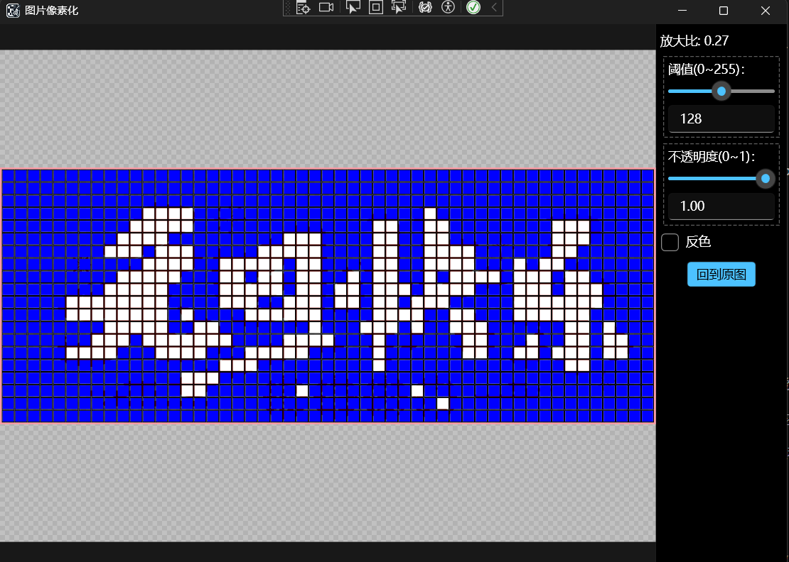

# Pic2Pixels

**Turn photos into editable pixel grids for pixel art, mosaic planning, and pixel-wall references.**

[](https://github.com/TreatTrick/Pic2Pixels/releases/latest)
[](https://github.com/TreatTrick/Pic2Pixels/stargazers)
[](LICENSE)

Pic2Pixels is a Windows desktop tool that converts a JPG or PNG photo into a two-tone, cell-by-cell pixel grid. Adjust the crop, grid dimensions, and grayscale threshold, then edit individual cells and save named projects for later reference.

## Features

- Import one JPG, JPEG, or PNG image by dragging it into the app, or paste an image or image path from the clipboard.
- Zoom and move the source image to choose the crop area before pixelating it.
- Set the grid width and height independently, from 1 to 1,000 cells.
- Tune the grayscale threshold to control which cells become blue or white.
- Toggle cells by clicking them; invert the grid colors and adjust the grid overlay opacity.
- Show row and column rulers, save named grid projects, and browse the local project history.

The current app creates an editable blue-and-white grid for visual reference. It does not export the grid as an image or a printable pattern file.

## Preview

| Original image | Pixel grid |
| --- | --- |
|  |  |

## Download

Download the standalone `Pic2PixelStylet.exe` or the ZIP package from [GitHub Releases](https://github.com/TreatTrick/Pic2Pixels/releases/latest). The executable is self-contained and does not require a separate .NET installation.

## Use the app

The app interface is currently in Simplified Chinese.

1. Drag one JPG or PNG file into the window, or copy an image (or its file path) and press `Ctrl+V`.
2. Set the grid width and height.
3. Zoom with the mouse wheel and drag the image to position the crop.
4. Select **像素化** (Pixelate) to create the grid.
5. Adjust the threshold, opacity, or inverse-color setting, then click cells to refine the pattern.
6. Save the named project to find it again in the local history.

Saved projects contain the grid and its crop-position metadata. The original source image is not copied into the project record.

## Build from source

Requirements: Windows and the .NET 9 SDK.

```powershell
git clone https://github.com/TreatTrick/Pic2Pixels.git
cd Pic2Pixels
dotnet build Pic2PixelStylet.sln --configuration Release
dotnet run --project Pic2PixelStylet/Pic2PixelStylet.csproj
```

To publish a self-contained Windows x64 build locally:

```powershell
dotnet publish Pic2PixelStylet/Pic2PixelStylet.csproj `
  --configuration Release `
  --runtime win-x64 `
  --self-contained true `
  -p:PublishSingleFile=true `
  -p:IncludeNativeLibrariesForSelfExtract=true
```

## Technology

- C# and WPF on .NET 9
- SQLite project history with JSON grid data
- Windows x64 desktop application

## Contributing

Bug reports and feature suggestions are welcome in [GitHub Issues](https://github.com/TreatTrick/Pic2Pixels/issues). Before opening an issue, check that it has not already been reported.

If Pic2Pixels is useful to you, please consider [starring the repository](https://github.com/TreatTrick/Pic2Pixels/stargazers) to help more people find it.

## License

Pic2Pixels is released under the [MIT License](LICENSE).

---

## 中文说明

**Pic2Pixels 是一款 Windows 图片转像素格工具，可将照片转换为可编辑的蓝白二值网格，用于像素画、马赛克排布和像素墙制作参考。**

### 功能

- 拖入单张 JPG、JPEG 或 PNG 图片，也可以粘贴图片或图片路径。
- 缩放、拖动原图，调整裁切区域。
- 分别设置网格宽度和高度，范围为 1 到 1,000 格。
- 调整灰度阈值，控制每个格子显示为蓝色或白色。
- 点击格子逐个修改，支持反色和网格透明度调整。
- 显示行列标尺，按名称保存网格方案并查看本机历史记录。

当前版本用于生成和编辑蓝白网格参考，不支持将网格导出为图片或可打印的图纸文件。保存的项目包含网格和裁切位置数据，不会把原始图片复制到项目记录中。

### 下载和运行

从 [GitHub Releases](https://github.com/TreatTrick/Pic2Pixels/releases/latest) 下载独立的 `Pic2PixelStylet.exe`，或下载 ZIP 后解压运行。程序自带运行时，无需单独安装 .NET。

### 从源码构建

需要 Windows 和 .NET 9 SDK：

```powershell
git clone https://github.com/TreatTrick/Pic2Pixels.git
cd Pic2Pixels
dotnet build Pic2PixelStylet.sln --configuration Release
dotnet run --project Pic2PixelStylet/Pic2PixelStylet.csproj
```

### 参与改进

欢迎在 [Issues](https://github.com/TreatTrick/Pic2Pixels/issues) 中反馈问题或提出功能建议。如果 Pic2Pixels 对你有帮助，也欢迎给仓库点一个 [Star](https://github.com/TreatTrick/Pic2Pixels/stargazers)，让更多人发现它。
